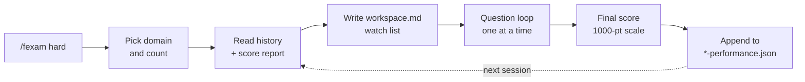

# Claude Exam Prep

**Scenario-based practice for both Claude Certified Architect exams, built as a stand alone [app](#the-app-practice-and-stats), or Claude Code commands.**
Claude writes the questions, grades your answers, names the trap you fell for, and keeps a local record so every session aims at what you're getting wrong.

| | Foundations (CCAR-F) | Professional (CCAR-P) |
|---|---|---|
| Command | `/fexam` | `/pexam` |
| Domains | 5 | 7 |
| Passing score | 720 / 1000 | 720 / 1000 |
| Score-report weighting | ✅ | — |

---

## Contents

- [Quick start](#quick-start)
- [Commands and modes](#commands-and-modes)
- [The app: practice and stats](#the-app-practice-and-stats)
- [How a session works](#how-a-session-works)
- [Tracking your progress](#tracking-your-progress)
- [Retake mode: score-report weighting](#retake-mode-score-report-weighting-fexam)
- [Exam coverage](#exam-coverage)
- [Bonus: quiz-pdf](#bonus-quiz-pdf)
- [Design: the Kiln palette](#design-the-kiln-palette)
- [Project layout](#project-layout)
- [Customizing and contributing](#customizing-and-contributing)
- [Privacy](#privacy)
- [License](#license)

---

## Quick start

### Claude Code commands:

**You need:** [Claude Code](https://claude.ai/code) (CLI, desktop app or IDE extension) and `python3` on your PATH. The commands use Python for every score and percentage, so the numbers are never computed in Claude's head.

```bash
git clone https://github.com/d-r-eng/claude-exam-prep.git
cd claude-exam-prep
claude
```

Then, inside Claude Code:

```
/fexam medium     # Foundations, scenario questions, feedback after each answer
/pexam hard       # Professional, multi-concept trade-offs
/fexam stats      # no questions — your history, weak spots and recurring traps
```

Claude asks two things before Question 1: **which domain** (or all of them) and **how many questions** (default 15). There's nothing else to configure.

---

## Commands and modes

Both commands take one argument:

| Argument | What you get | Feedback |
|---|---|---|
| `easy` | Direct recall, one concept. Wrong options are clearly wrong if you studied. | After each answer |
| `medium` | A realistic scenario around one concept. One distractor has a clear flaw. | After each answer |
| `hard` | Two or more interacting concepts. Every option is defensible; one is strictly correct. | After each answer |
| `absurd` | Maximum deception. Every option looks right and at least one is a known exam trap. Needs precise rule recall. | After each answer |
| `exam` | Hard-style questions in **silent mode**, like the real thing. | Only at the end, with a full breakdown |
| `stats` | No questions. A report built from your saved history. | — |

After each answer (every mode except `exam`) you get:

1. **Correct ✅** or **Incorrect ❌**
2. On a miss, the **trap you triggered**, as a `snake_case` label plus one sentence on why it catches people (for example `hook_stdout_or_exit1_reaches_claude`)
3. Why the correct answer is right
4. Why each wrong option is wrong
5. For `/fexam` retake questions: how you scored on that objective in the real exam

---

## The app: practice and stats

A local web app in the Kiln design. **Practice** runs your real `/fexam` and `/pexam` commands with clickable screens, and **Stats** shows your whole history.

```bash
python3 app/serve.py          # then open http://localhost:8765/practice
```

**How it works.** Each practice session is a real Claude Code conversation in this folder, using your normal Claude Code login and default model. The app sends `/fexam hard` (or whatever you picked), answers the command's domain and question-count prompts with your choices from the setup screen, and then sends each answer you click. The command does everything it does in the terminal: it reads your history and score report, writes `workspace.md`, plans the session, gives feedback, and appends the session to `fexam-performance.json` itself.

The command files aren't changed. The app adds one instruction, `app/ui_protocol.md` (passed with `--append-system-prompt-file`), asking Claude to end each reply with a small hidden JSON block that mirrors what it said. The app draws the screens from that block. Claude's full reply is always one click away, and if a block is ever missing the app shows the reply as text with a box to answer.

- **Tools Claude may use:** Read; `python3 -c` and `date` (for the command's arithmetic and dates); and writing `fexam-performance.json`, `pexam-performance.json` and `workspace.md`. Everything else is refused, and any refused call is shown in the sidebar. Note that `python3 -c` can run arbitrary Python, so this limits the form of the command, not what it could do.
- **Resumable.** Sessions are saved Claude Code conversations. Unfinished ones appear on the setup screen, and each session shows its `claude --resume <id>` command so you can continue in a terminal. The app keeps a transcript of each session in `.exam-app/sessions/` (gitignored).
- **Talk to Claude.** A message box under each question goes to the same session, for "explain more", "re-drill O20" and so on.
- **Timing and usage.** The first question takes about 40–50 seconds while the command reads your files and plans the session. After that, each answer takes about 15–20 seconds. Every turn is a full Claude Code request that counts toward your plan, which costs more than a plain chat because the whole command and session are in context.
- **Keyboard:** A–D or 1–4 to pick, Enter to submit and to go to the next question.

| Option | What it does |
|---|---|
| `--port 9000` | Port (default 8765) |
| `--root PATH` | Project folder with `.claude/commands` and your data (default: this repo) |
| `--claude PATH` | Path to the `claude` binary if it isn't on `PATH` |
| `--open` | Open the app in a browser |

**WSL:** run it inside WSL from this folder and open `http://localhost:8765/practice` in your Windows browser. WSL 2 forwards localhost by default. If the page says Claude Code isn't ready, run `claude` once in that terminal to sign in. It's also worth running `claude` interactively in this folder once so the project's own settings are trusted.

Stats doesn't call Claude. It reads your files fresh on every load, using the same rules as `/fexam stats`. Older history records are handled: questions without a `domain` get it from their subtopic code, and missing subtopic labels come from the command files.

```bash
python3 -m unittest discover -s app -p "test_*.py"    # stats + command-driver tests (stub claude, no usage)
```
---

## How a session works



- **Before Question 1**, Claude reads your history and writes `workspace.md`: the session plan, subtopics you're below 70% on, and the traps you keep choosing. If anything is weak, you'll see a short **Watch:** line too.
- **During the session**, questions come one at a time, labelled with number and domain (e.g. *Question 3/15 — Domain 1*).
- **At the end** you get your score, a 1000-point weighted domain table with PASS/FAIL against 720 (when you practised all domains), the questions you missed with their traps, and an offer to re-drill. The session is then appended to your performance file.

---

## Tracking your progress

Everything stays in plain files in the project folder, all of them gitignored:

| File | What it holds | Written by |
|---|---|---|
| `fexam-performance.json` / `pexam-performance.json` | One record per session: date, difficulty, domain filter, score, and per question the domain, subtopic, objective, your letter, whether it was right and the trap triggered | The command, at session end |
| `workspace.md` | The plan for the session about to start: focus, retake targets, watch list, recurring traps and a blank notes area. Overwritten each run; not a log. | The command, at session start |
| `fexam-scorereport.json` | Your official CCAR-F score report, transcribed per objective | You |

`/fexam stats` and `/pexam stats` turn that history into:

- **Recent sessions**: the last five, with score and %
- **Subtopic accuracy**: every subtopic with 2 or more attempts, weakest first, ⚠️ below 70%
- **Weighted domain score**: a projected 1000-point score from the official domain weights, with PASS/FAIL once every domain has attempts
- **Recurring traps**: any trap you've chosen twice or more, with a one-line reminder
- **Exam objectives vs practice** and **edge progress** (`/fexam` with a score report only)

<details>
<summary>Performance record schema</summary>

```json
{
  "sessions": [
    {
      "date": "2026-10-06",
      "difficulty": "hard",
      "domain_filter": "all",
      "score": 12,
      "total": 15,
      "questions": [
        {
          "domain": "D3",
          "subtopic": "3.8",
          "subtopic_label": "Claude Code hooks",
          "objective": "O12",
          "edge": "O12.e2",
          "correct": false,
          "chosen": "D",
          "trick": "hook_stdout_or_exit1_reaches_claude",
          "trick_description": "Only exit code 2 (stderr) reaches Claude; stdout and exit 1 go to the user."
        }
      ]
    }
  ]
}
```

`objective` and `edge` are `/fexam`-only and appear when a score report is present. `trick` and `trick_description` are `null` on correct answers.
</details>

---

## Retake mode: score-report weighting (`/fexam`)

If you've sat the Foundations exam and didn't pass, put your score report in the project root as **`fexam-scorereport.json`**. From then on `/fexam` stops sampling by domain weight and goes after what the real exam caught you on.

**Tiers**, derived from each objective's `exam_pct`:

| Tier | Exam result | Share of each session |
|---|---|---|
| 1 | 0% | 40% |
| 2 | 1–99% | 30% |
| 3 | 100% | 30% (spread by domain weight) |

**Edges.** Tier 1 and 2 objectives list the specific traps the exam can test, with stable IDs like `O20.e1`. Each question is built on exactly one edge. An edge **retires after 5 correct answers** across all sessions, and Claude then moves on to that objective's other edges. Objectives never change tier from practice alone; only a new score report does that.

After a retake, replace the file with the new percentages. Tiers are recalculated automatically and the command doesn't need editing.

<details>
<summary>Score-report shape</summary>

```json
{
  "exam": "CCAR-F",
  "attempt_date": "2026-09-11",
  "score": 667,
  "passing_score": 720,
  "tier_rules": { "tier1": "exam_pct == 0", "tier2": "0 < exam_pct < 100", "tier3": "exam_pct == 100" },
  "session_mix": { "tier1": 0.4, "tier2": 0.3, "tier3": 0.3 },
  "retire_after_correct": 5,
  "objectives": [
    {
      "id": "O12",
      "text": "PostToolUse hooks that automatically enforce code quality …",
      "exam_pct": 0,
      "tier": 1,
      "domain": "D3",
      "subtopics": ["3.8"],
      "angle": "What the real exam tests and which distractors it uses …",
      "edges": [{ "id": "O12.e1", "text": "Formatter/linter after every edit: PostToolUse hook …" }]
    }
  ]
}
```

Every objective's `subtopics` must use codes that exist in `.claude/commands/fexam.md`.
</details>

---

## Exam coverage

### Foundations: 5 domains

| # | Domain | Weight |
|---|---|---|
| D1 | Agentic Architecture & Orchestration | 27% |
| D2 | Tool Design & MCP Integration | 18% |
| D3 | Claude Code Configuration & Workflows | 20% |
| D4 | Prompt Engineering & Structured Output | 20% |
| D5 | Context Management & Reliability | 15% |

### Professional: 7 domains

| # | Domain | Weight |
|---|---|---|
| D1 | Solution Design & Architecture | 17% |
| D2 | Claude Models, Prompting & Context Engineering | 13% |
| D3 | Integration | 19% |
| D4 | Evaluation, Testing & Optimization | 16% |
| D5 | Governance, Safety & Risk Management | 14% |
| D6 | Stakeholder Communication & Lifecycle Management | 14% |
| D7 | Developer Productivity & Operational Enablement | 7% |

The Professional command also carries a **High-Yield Heuristics** section: the exam rewards the simplest architecture that meets requirements, least privilege, measurable outcomes, evaluation before optimization, governance by design and explicit trade-off reasoning.

---

## Bonus: quiz-pdf

`quiz-pdf/` is a standalone Claude Code skill that turns any JSON question bank into an **e-reader flashcard PDF**: question and choices on one page, answer and explanation on the next. It's pure Python standard library and renders through headless Chrome or Edge, with no network access and no tokens spent per render.

```bash
python quiz-pdf/scripts/build_quiz_pdf.py quiz-pdf/references/example.json --page scribe
```

| Flag | Default | Options |
|---|---|---|
| `--page` | `scribe` | `scribe` · `remarkable` · `paperwhite` · `generic-6` · `a4` · `letter` |
| `--mode` | `flip` | `flip` (flashcards) · `review` (answers inline) |
| `--font` | `sans` | `sans` · `serif` |
| `--shuffle` | off | Shuffle within each section |
| `--no-pdf` | off | HTML only, then Print → Save as PDF |

To use it as `/quiz-pdf`, copy the folder to `.claude/skills/quiz-pdf/` (this project) or `~/.claude/skills/quiz-pdf/` (all projects). See [`quiz-pdf/README.md`](quiz-pdf/README.md) and [`quiz-pdf/references/schema.md`](quiz-pdf/references/schema.md).

---

## Design: the Kiln palette

The project has a visual identity for any web front end, dashboard or exported report built on top of it. **Kiln** belongs to the Claude family but is its own system: a parchment ground instead of ivory, a fired ember darker than Claude's clay, and a juniper green that carries "correct".

| Token | Light | Dark | Used for |
|---|---|---|---|
| Paper | `#F4EFE6` | `#1A1714` | App background |
| Card | `#FBF8F3` | `#24201C` | Raised surfaces |
| Ink | `#201C17` | `#F2EBDF` | Text |
| **Ember** | `#B84E2A` | `#E5845A` | Primary actions, selection, focus, progress |
| **Juniper** | `#2D5F58` | `#7BBDAF` | Correct, tier 3, retired edges |
| **Wine** | `#93304A` | `#E58AA2` | Wrong pick, tier 1 |
| **Ochre** | `#C99A2E` | `#E2B24E` | Traps, watch list, tier 2 |

**Type:** Fraunces (display and scores) · Instrument Sans (questions and body) · JetBrains Mono (trap labels, subtopic and objective codes).

**Rules:** right and wrong never rely on colour alone. Correct gets a check mark and a solid edge, a wrong pick gets a cross and a dashed edge. Text meets 4.5:1 contrast, and touch targets are at least 44 px.

All tokens, light and dark, are in [`design/tokens.css`](design/tokens.css):

```html
<link rel="stylesheet" href="design/tokens.css">
<button style="background: var(--kiln-ember); color: var(--kiln-on-accent)">Submit answer</button>
```

---

## Project layout

```
.claude/
  commands/
    fexam.md            # /fexam — Foundations: rules, domain content, distractor bank, question bank, logging
    pexam.md            # /pexam — Professional: same structure + high-yield heuristics
  settings.json         # allows `python3 -c` so scoring runs without prompts
CLAUDE.md               # architecture notes for Claude Code when editing this repo
app/
  serve.py              # local app: python3 app/serve.py → /practice and / (stats)
  command.py            # runs the real /fexam and /pexam through `claude -p`, resumable sessions
  ui_protocol.md        # the one added instruction: end each reply with a hidden exam-ui JSON block
  stats.py              # stats engine, mirrors the commands' stats mode
  test_*.py
  web/                  # practice + stats pages (vanilla JS), styled with design/tokens.css
design/
  tokens.css            # Kiln design tokens (light + dark)
quiz-pdf/               # bonus skill: JSON question bank → flashcard PDF
  SKILL.md
  scripts/build_quiz_pdf.py
  references/{schema.md, example.json}
README.md
LICENSE

# generated locally, gitignored
fexam-performance.json  pexam-performance.json  fexam-scorereport.json  workspace.md
```

There's no build step and no dependency beyond Python's standard library. Each command is one structured prompt: frontmatter, difficulty rules, an arithmetic rule, session flow, domain content with subtopic codes, question guidelines, a distractor bank, a reference question bank and the logging schema.

---

## Customizing and contributing

All exam content lives in the two command files. [`CLAUDE.md`](CLAUDE.md) documents their structure in detail.

- **Add a topic:** add a numbered subtopic under its domain. **Never renumber existing codes**, because your history refers to them.
- **Add a distractor:** extend the distractor bank. Keep the pattern of one strictly correct answer and three plausible wrong ones.
- **Change domain weights:** update the Exam Overview table and keep the total at 100%.
- **Change session length:** the default of 15 is in the Session Format section, and you can override it at the start of any session.

Issues and pull requests are welcome, especially reports of questions that are ambiguous or out of date.

---

## Privacy

Your history, score report and session plans never leave your machine through this repo. They're all listed in `.gitignore`, along with `.claude/settings.local.json` and `memory/`. Check `git status` before committing anything else you've exported into the folder.

---

## License

[Apache 2.0](LICENSE).

> This is an independent study aid. It isn't affiliated with or endorsed by Anthropic, and its questions are generated practice material, not real exam items.
